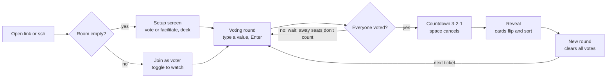
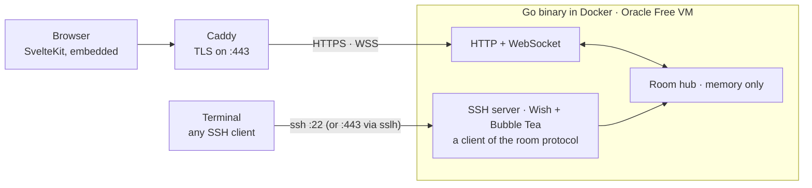

# Planning Poker — v1 Spec

Oct 12, 2026 · reh2ur

## Summary and principles

A free, ad-free, keyboard-first planning poker tool that a team joins from the browser or from the terminal via SSH, and that stores nothing. It replaces the ad-filled third-party tool the team uses today, and doubles as an open-source showcase built with agentic coding.

The core is a reliable, polished web app. SSH is the same keyboard-first experience through a second channel, and it is the signature feature.

Principles that decide every trade-off:

- **Store nothing.** No database, no ticket data, no participant history, no analytics. A room exists only while someone is in it.
- **Nothing sensitive in the room.** Only display names, votes and the deck. No ticket titles, so there is nothing to protect.
- **Fix what the other tools get wrong.** No duplicate people after reconnects, no ghost participants, reveal never blocked, no clutter.
- **Keyboard-first everywhere.** Type a value, press Enter. Same interaction model in browser and terminal.
- **No roles.** Everyone in a room can do everything; the team is trusted.
- **By devs, for devs.** No accounts, no cookie banner, no terms to accept.

## Scope

v1 is one room type, two clients and a reveal that feels good. Everything that implies storing or integrating is out.

**In v1**

- Rooms addressed by an identifier: random by default, or a custom name like `team-checkout`
- First person in an empty room sets it up (voter or observer, deck); later joiners go straight in as voters
- Seat modes: voting or watching, switchable any time by anyone for themselves
- Decks: Fibonacci `0 1 2 3 5 8 13 21` (default) and T-shirt `XS S M L XL`, each with `?` and coffee cards; chosen at setup
- Type-to-select voting with prefix highlight, Enter commits
- Auto-reveal with a short, cancellable countdown once everyone present has voted; manual reveal any time
- Result: cards flip and sort, distribution line, consensus moment, outliers named; average only for numeric decks, rounded to a card
- New round clears all votes
- Reconnect keeps your seat; away seats never block and disappear after a few minutes
- Rehydration after a server restart from browsers that were just connected
- Web: setup screen, voter view, presenter view for screen sharing
- SSH: lobby, direct join with `-t`, line mode without `-t`, responsive TUI

**Explicitly out of v1**

- Ticket titles, ticket queues, Jira or Linear integration (local or cloud)
- History, export, statistics, any persistence
- Roles, permissions, kicking, room settings beyond the deck
- Custom decks
- Accounts, SSO, SSH key allowlists
- End-to-end encryption (incompatible with a server-rendered TUI, and unnecessary without ticket data)
- Splitting SSH into a separate gateway process (designed for, not built)

## Core concepts

A room is a string, not a record. It lives in server memory while at least one participant is connected and vanishes when the last one leaves.

| Concept | What it is | Where it lives |
| --- | --- | --- |
| Room | An identifier (random or custom) plus live state: deck, round, votes, revealed flag | Server memory; browsers keep a backup copy |
| Participant | A seat with display name, seat mode, connection status (online/away) | Server memory |
| Participant token | Random ID that makes a reconnect take back the same seat | Browser: localStorage. SSH: none (new seat per session) |
| Display name | Shown on the table | Browser: localStorage. SSH: from the SSH username, editable |
| Seat mode | Voting or watching. Watchers don't sit at the table and don't count for reveal or results | Per participant |
| Deck | Fibonacci or T-shirt, plus `?` and coffee | Room state, set by the first joiner |
| Round | Votes hidden until reveal; reveal shows the result; new round clears it | Room state |

Identity rules:

- Reloads and extra tabs in the same browser share one token, so one seat.
- A different browser, or SSH alongside the browser, is a separate seat. That's accepted.
- A disconnected seat shows as away, never blocks a reveal, and is dropped after a few minutes; anyone can remove an away seat immediately.
- The server never stores SSH key fingerprints or any mapping of keys to names.

## User flows

There is no separate "create room" step: opening an empty room is creating it.



Last person leaves: the room is gone. The same link later starts again at the setup screen. Anyone can press `r` to reveal at any time without waiting.

**Joining from the web**

1. The PM opens a new random room (or the team's bookmarked custom link).
2. First person in: setup screen with Vote or Facilitate, then the deck.
3. Everyone after: name (pre-filled), voting by default, toggle to watch.

**Joining via SSH**

The SSH username is always the person's name; the room travels as a command, the way Git passes a repo path.

```
ssh poker.example.com              # lobby: paste room code or web link, full TUI
ssh -t poker.example.com abc123    # straight into the room, full TUI
ssh poker.example.com abc123       # no -t: line mode, works without a terminal
ssh Alex@poker.example.com         # name = Alex instead of the local username
```

README tip for regulars: `User`, `SetEnv POKER_NAME=…` and `RequestTTY yes` in `~/.ssh/config`.

**Reveal and result**

- Cards flip, then sort by value; distribution line such as `3×5 · 1×8 · 1×3`.
- Consensus (everyone the same, ignoring `?` and coffee): a celebratory moment.
- Spread of two or more steps: lowest and highest voters highlighted by name, to start the discussion.
- `?` and coffee are shown but excluded from the math. No accepted-estimate field; the number goes into Jira by hand.

## Web and terminal UX

One interaction model in both clients: type a value, see it highlighted, press Enter.

**Type-to-select**

- Prefix matching with live highlight: `1` highlights 1, `13` highlights 13, `x` then `l` highlights XL.
- Enter always commits, because `1` is a prefix of `13`. Esc or Backspace edits.
- `?` and `c` select the special cards directly.
- Other keys: `r` reveal, `n` new round, `v` toggle voting/watching. Space cancels a running countdown.

**Web**

- Look: mobile-first app on a desktop. One centered, focused column, bold type, glass and transparency for the frame.
- Cards, names and results stay solid and high-contrast, because they get viewed through compressed video when the PM shares the screen.
- Setup screen (first joiner): two big choices, Vote or Facilitate, with the deck picker smaller below. A `?deck=tshirt` link parameter pre-selects the deck.
- Join screen (later joiners): name pre-filled from localStorage, voting by default, a toggle to watch instead.
- Voter view: compact table, your hand of cards, progress ("4 of 6 voted").
- Presenter view (watchers): fills the screen, large table and names, progress, reveal and results front and center, no hand of cards. Built for screen sharing.
- Watchers appear as a quiet "2 watching" indicator with names on hover, not as seats.
- Every action is shown briefly in the room ("Anna revealed").
- Animations: cards fly to the table, flip on reveal, sort by value, stack on consensus.
- Copy buttons: web link and the `ssh -t` command.

**Terminal (responsive TUI)**

The layout is chosen by terminal size and switches live on resize.

| Size | Layout | Shows |
| --- | --- | --- |
| Large, about 90×20 | Card hand | Drawn cards that flip on reveal, progress, pending names |
| Normal, about 60×14 | Table | Room name, deck, seats with status, card row, key hints |
| Narrow, under about 60 columns | Status line | Room, progress, your vote, key hints in one row |
| No terminal (no `-t`) | Line mode | Events as lines, a `vote ›` prompt, hint to add `-t` |

On reveal, votes flip in place and a distribution bar replaces the card row. Presenter view is browser-only.

## Architecture

One Go binary holds all rooms in memory and speaks one protocol to two clients. The SSH side is built strictly as a client of that protocol, so it can later move into its own process.



Deploy: GitHub Actions → GHCR image → VM over Tailscale SSH.

**Components**

- **Room hub:** in-memory map of room ID to room state. Server-authoritative while running; first write wins (two people setting up the same empty room at once).
- **Web:** SvelteKit built as static files, embedded with `go:embed` (`make build` copies `web/build` into `internal/web/dist`; only a `.gitkeep` is tracked, so Go builds without a web build and then answers 503 for the app shell). Unknown paths without a file extension get `index.html` (room URLs); unknown asset paths get 404. Tailwind for styling. WebSocket for live state, with heartbeats and auto-reconnect.
- **SSH:** Charm's Wish, Bubble Tea and Lip Gloss. Each session is a participant object in a room, like a WebSocket connection. Username = display name; the command argument = room ID; no PTY = line mode.
- **Caddy** in front for automatic HTTPS. Optional sslh to multiplex SSH and HTTPS on port 443 if port 22 is blocked.

**Protocol rules (needed from day one)**

- Every client has a stable participant token; join is idempotent, so a reconnect takes back the seat instead of creating a duplicate.
- Each server start gets a random instance ID. After a restart, a browser that was connected to the previous instance within about a minute resends deck, seat mode, its vote and the revealed flag. Stale tabs just join normally.
- Messages are versioned, so a separate SSH gateway can be split out later without a rewrite.

**Hosting and delivery**

- Oracle Cloud Always Free ARM VM in an EU region (2 OCPU, 12 GB), Docker, admin access via Tailscale only.
- GitHub Actions builds a multi-arch image to GHCR and deploys over Tailscale SSH.
- The public instance is a personal instance and not advertised; others self-host the image or the binary.
- Later option: split the SSH gateway into its own rarely-restarted container, so deploys of the core never drop terminal users.

## Privacy

Privacy comes from having nothing worth protecting, not from cryptography. A room holds only display names, votes and a deck, and only in memory.

- The server is trusted while a room is live; it must be, because it renders the SSH TUI.
- No database, no disk snapshots, no analytics, no third-party scripts or fonts loaded at runtime.
- Access logs off, or without IP addresses. Error logs never contain room names or display names.
- The browser's localStorage holds only the participant token, display name and the room backup for rehydration. That's strictly necessary for the function, so the aim is no cookie banner. To be confirmed, not legal advice.
- Custom room names are guessable. Anyone who knows `team-checkout` can join. Acceptable, since there's nothing secret in a room; random IDs are the default.
- TLS uses one wildcard certificate if subdomains are ever used, so room names never appear in public Certificate Transparency logs.

## Risks, validation and open items

Validate SSH through a corporate proxy or firewall first. If it fails, the signature feature needs the 443 fallback or becomes a home-office-only feature.

**Validate first**

- [ ] From a laptop on a corporate network: `ssh terminal.shop`, then `ssh -T git@github.com`, then `ssh -p 443` against a test host
- [ ] Spike: a Wish server on the Oracle VM with a 10-line Bubble Tea app, reached from a laptop on a corporate network
- [ ] WebSocket through a corporate proxy to the Oracle VM (long-lived connection, no drops after idle)
- [ ] Glass design through a real Teams or Meet screen share

**Risks**

| Risk | Impact | Mitigation |
| --- | --- | --- |
| Outbound SSH blocked by a corporate proxy or firewall | SSH join unusable at work | sslh on port 443 multiplexing SSH and HTTPS; worst case, SSH only from home |
| Corporate TLS inspection breaks or times out WebSockets | Web app unreliable | Heartbeats, auto-reconnect, fallback to long polling if needed |
| Deploy during a meeting | Everyone reconnects | Rehydration from browsers; SSH users re-run `ssh` |
| Oracle Always Free VM reclaimed or rebooted | Outage | Docker image runs anywhere; idle-reclamation rules to check |
| Building two polished UIs | Scope creep | Web first; TUI starts with table and line mode, card hand last |

**Open items with recommendations**

- **Mobile web:** responsive by design (mobile-first column); no native app.
- **License:** MIT or Apache-2.0 for maximum reuse; AGPL only if you want forks of hosted versions to share changes.
- **Self-hosting:** one Docker image and one binary; configuration through a handful of env vars (domain, ports, SSH host key path, away timeout).
- **SSH host key:** the only file the server reads. Lives outside the image and repo at `POKER_SSH_HOST_KEY_PATH`, generated once by the operator. In production the server refuses to start without it, so the key never rotates silently; in development an ephemeral key is generated with a warning.
- **Naming:** open. Should work as a hostname and an SSH command, for example `ssh <name>.dev`.
- **Rate limiting:** basic per-IP limits on room creation and connections, kept in memory only.
- **Subdomains for rooms:** possible for the web only; not planned, since they can't carry the room for SSH.
